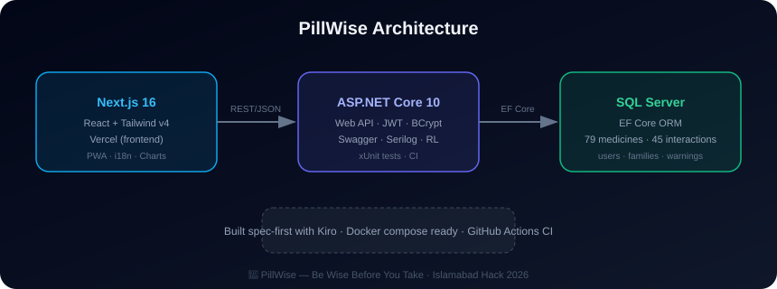

# 💊 PillWise — Medicine Interaction Checker

> **Be Wise Before You Take**

PillWise is a medicine safety app that checks if your medicines are safe to take together — before you swallow them.

Built for **Islamabad Hack 2026** — Community & Society Track



> **Demo:** see [DEMO.md](DEMO.md) for the 4-minute pitch script · **Kiro:** see [KIRO.md](KIRO.md) for our AI workflow

## 🎯 Problem

Every year, thousands die from preventable medicine interactions. In Pakistan:
- 1 in 5 medicines is substandard or fake
- Elderly take 5+ medicines daily with no way to check interactions
- Pharmacists substitute medicines without telling patients

## ✅ Solution

PillWise lets users:
- 🔍 Search 79 medicines by name or category (with voice input + **fuzzy search** — "panadl" still finds Panadol)
- 📷 **Barcode scanner** — point camera at a medicine box to identify it instantly
- ⚡ Select multiple medicines and check interactions instantly (radar scan + confetti)
- 🔗 **Share Card** — export any result as a 1080×1080 PNG for family WhatsApp groups
- ⏰ **Dose reminders** via browser notifications
- 💊 Animated pill/capsule visuals per medicine
- 🤖 AI health chatbot for medicine questions
- 👤 Track personal medicine list
- 👨‍👩‍👧 Manage family members' medicines separately
- 📊 View safety dashboard with warnings & interaction heatmap
- 💊 Dosage calculator (by age/weight)
- ⚠️ Allergy checker & safety alternatives (pregnancy, kidney, liver, meal timing)
- 📅 Expiry tracker & health journal
- 📄 Export reports as PDF
- 🌐 English + Urdu (اردو) language toggle
- 📱 PWA — installable, works offline
- ☀️ **Light/dark theme** toggle + **accessible** (skip-link, aria-labels, keyboard nav)
- 🐳 **Docker Compose** — one command runs SQL Server + API + frontend
- 🗣️ Voice search & share results
- 🩺 Doctor Mode — printable summary for consultations
- 🧪 Demo mode & statistics dashboard
- 📈 Live charts (safety donut, weekly activity, medicine type breakdown)
- ✨ Rich animations — page transitions, scroll reveals, animated counters, radar scanner, confetti, aurora backgrounds, 3D tilt cards

## 🛠️ Tech Stack

| Layer | Technology |
|-------|-----------|
| Frontend | Next.js 16, React, TypeScript, Tailwind CSS |
| Backend | ASP.NET Core 10 Web API (C#) |
| ORM | Entity Framework Core |
| Database | Microsoft SQL Server |
| AI Tool | Kiro (AWS AI IDE) |

## 🚀 Getting Started

### Prerequisites
- .NET 10 SDK
- Node.js 18+
- SQL Server (Express or LocalDB)

### Backend Setup
```bash
cd backend/PillWise.API
dotnet restore
dotnet run
```
API runs at: `http://localhost:5198`

### Frontend Setup
```bash
cd frontend
npm install
npm run dev
```
Frontend runs at: `http://localhost:3000`

### Database
Connect to SQL Server and run the SQL scripts in `database/` folder.
A fresh database is auto-created and seeded on first API start (`Data/DbSeeder.cs`).

### Docker (all-in-one)
```bash
docker compose up --build
```
Frontend: `http://localhost:3000` · API: `http://localhost:5198/swagger` · SQL: `localhost,1433`

### Cloud deploy
See [docs/AZURE_DEPLOY.md](docs/AZURE_DEPLOY.md) for Azure + Vercel setup.

## 📁 Project Structure

```
PillWise/
├── backend/
│   ├── PillWise.API/           # ASP.NET Core Web API
│   │   ├── Controllers/        # API endpoints
│   │   ├── Models/             # Entity models
│   │   ├── Data/               # DbContext
│   │   └── DTOs/               # Data transfer objects
│   └── PillWise.Tests/         # xUnit unit tests (7 tests)
├── frontend/                   # Next.js app
│   ├── app/                    # Pages (landing, home, search, checker...)
│   ├── components/             # UI components (chatbot, PDF, tools...)
│   └── lib/                    # API client, i18n, icons
├── database/                   # SQL scripts
└── .github/workflows/ci.yml    # CI: build + test (backend & frontend)
```

## 📊 API Endpoints

| Method | Endpoint | Description |
|--------|----------|-------------|
| POST | /api/auth/register | Register user |
| POST | /api/auth/login | Login user |
| GET | /api/medicines | Search medicines |
| GET | /api/medicines/{id} | Get medicine details |
| POST | /api/interactions/check | Check interactions ⭐ |
| GET | /api/usermedicines | Get user's medicines |
| POST | /api/usermedicines | Add medicine |
| GET | /api/family | Get family members |
| GET | /api/dashboard/stats | Get dashboard stats |
| GET | /swagger | Interactive API docs (Swagger UI) |

## ✅ Testing & CI

```bash
# Backend unit tests
cd backend
dotnet test

# Frontend build check
cd frontend
npm run build
```

GitHub Actions runs both automatically on every push (`.github/workflows/ci.yml`).

## 🏆 Hackathon Track

**Community & Society** — Health & safety for community

## 👥 Team PillWise

Built with ❤️ at Islamabad Hack 2026
